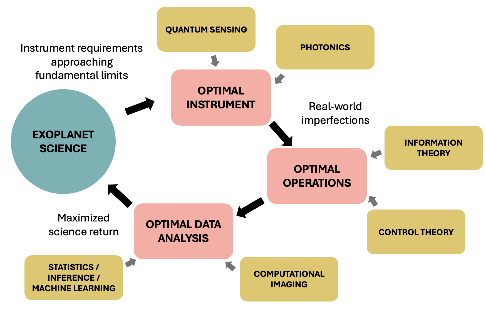

# Home
## About me

Hi! I am a postdoc at Leiden University in the group of Professor Sebastiaan Haffert. My research interests lie in developing information-optimal optical and near-infrared instrumentation for the detection, imaging, and spectroscopy of exoplanets. My work synthesizes information theory (quantum and classical), photonics, control systems engineering, and data science/computational imaging. The goal is to maximally reduce contamination from unwanted starlight: in hardware through instrument design and wavefront sensing and control, and in data post-processing with statistical methods.

Previously, I obtained a PhD in Physics at Caltech (in the Exoplanet Technology Lab led by Professor Dimitri Mawet), an MS in Aeronautics and Astronautics from MIT, and a BS in Physics from Caltech. I was a recipient of the NSF Graduate Research Fellowship.

Email: xin[at]strw.leidenuniv.nl  
Github: [yinzi-xin](https://github.com/yinzi-xin)  
ORCID: [https://orcid.org/0000-0002-6171-9081](https://orcid.org/0000-0002-6171-9081)

## First-author publications
Efficient detection and characterization of exoplanets within the diffraction limit: nulling with a mode-selective Photonic Lantern: [ApJ (Open Access)](https://iopscience.iop.org/article/10.3847/1538-4357/ac9284)

Laboratory demonstration of a Photonic Lantern Nuller in monochromatic and broadband light: [arXiv](https://arxiv.org/abs/2404.01426), [JATIS](https://www.spiedigitallibrary.org/journals/Journal-of-Astronomical-Telescopes-Instruments-and-Systems/volume-10/issue-2/025001/Laboratory-demonstration-of-a-Photonic-Lantern-Nuller-in-monochromatic-and/10.1117/1.JATIS.10.2.025001.short)

Implicit electric field conjugation with a Photonic Lantern Nuller: [arXiv](https://arxiv.org/pdf/2503.24292), [JATIS](https://www.spiedigitallibrary.org/journals/Journal-of-Astronomical-Telescopes-Instruments-and-Systems/volume-11/issue-2/025004/Implicit-electric-field-conjugation-with-a-photonic-lantern-nuller/10.1117/1.JATIS.11.2.025004.short)

On-sky speckle nulling through a single-mode fiber with the Keck Planet Imager and Characterizer: [arXiv](https://arxiv.org/abs/2307.11893), [JATIS](https://www.spiedigitallibrary.org/journals/Journal-of-Astronomical-Telescopes-Instruments-and-Systems/volume-9/issue-3/035001/On-sky-speckle-nulling-through-a-single-mode-fiber-with/10.1117/1.JATIS.9.3.035001.short?SSO=1)

Coronagraphic data post-processing using projections on instrumental modes: [ApJ (Open Access)](https://iopscience.iop.org/article/10.3847/1538-4357/ad1879)

Quantum-optimal coronagraphy with spatial mode sorting for direct exoplanet observations (under review): [arXiv](https://arxiv.org/abs/2607.02065)

## Projects

### Quantum-optimal mode-sorting coronagraphy

Coronagraphs (instruments that suppress starlight to boost our sensitivity to exoplanet signals) based on spatial mode-sorting are capable of achieving quantum-optimal measurements: the highest sensitivity measurements possible given the quantum states of the incoming astrophysical photons. I numerically calculated and investigated the behavior of [quantum-optimal mode-sorting coronagraphs](https://arxiv.org/abs/2607.02065) for realistic star-planet systems and telescope apertures.

I am currently working on designing and manufacturing a hardware prototype of these coronagraphs using multi-plane light converters. Check out the [code](https://github.com/yinzi-xin/backPAC) I've been developing to do this design!

### A photonic lantern coronagraph

During my PhD, I proposed the [Photonic Lantern Nuller (PLN)](https://iopscience.iop.org/article/10.3847/1538-4357/ac9284) instrument concept for the efficient detection and spectroscopic characterization of exoplanets within the diffraction limit - a regime inaccessible to conventional coronagraphs. Accessing closer-in separations would greatly increase the expected number of detectable planets, which scales inversely with the inner working angle. The PLN is a cross-aperture nuller that works by injecting light into a Mode-Selective Photonic Lantern (MSPL), leveraging the spatial symmetries of the device to cancel out on-axis starlight while letting off-axis planet light through. It was inspired by the Vortex Fiber Nuller (VFN) concept - however, a PLN retains more of the planet flux than the VFN because of its multiple ports, and can achieve higher sensitivity to planets.

The PLN has been [characterized in the lab](https://arxiv.org/abs/2404.01426) in monochromatic and broadband light. Its performance has been [improved with wavefront sensing and control techniques](https://arxiv.org/pdf/2503.24292), and it has been [demonstrated on-sky at the Subaru Telescope](https://arxiv.org/abs/2608.24308).

### Wavefront sensing and control

Speckle nulling is an established technique for destructively interfering starlight with itself by using a deformable mirror (DM) to modulate the phase of the light. In Fall 2022, I led the the effort to perform the [first on-sky demonstration of speckle nulling through a single-mode fiber](https://arxiv.org/abs/2307.11893) with the Keck Planet Imager and Characterizer (KPIC) instrument. It is also the first demonstration of speckle nulling that uses a high-resolution spectrograph simultaneously for wavefront sensing and for science-grade spectra.

Because techniques like speckle nulling and implicit electric field conjugation rely on a series of probes on the DM, we may be able to constrain the level of coherent starlight based on how it interferes with the probes. Improving constraints on the coherent light may be helpful in removing the effects of leaked starlight on the data.

### Data post-processing and analysis

Post-processing of coronagraphic data should take advantage of as many sources of information as it can to disentangle residual starlight from planet signal. I showed that the instrumental sensitivity of a coronagraph to wavefront error is one such source of information, and can be used to derive [robust observables](https://iopscience.iop.org/article/10.3847/1538-4357/ad1879) — a simple way to implement an instrument-motivated prior that improves the signal-to-noise ratio of planet signals.

### Other
The Deformable Mirror Demonstration Mission (DeMi) is a cubesat developed by the STARLab at MIT. It operated from 2020 to 2021 and tested a Microelectromechanical (MEMS) Deformable Mirror in space for the first time, raising its technology readiness level from 5 to 9. I was partly responsible for aligning the payload optics, and I also wrote and tested the wavefront control algorithm, which was successfully used in orbit (see [Morgan et al. 2022](https://www.spiedigitallibrary.org/conference-proceedings-of-spie/12185/2630563/On-orbit-operations-summary-for-the-Deformable-Mirror-Demonstration-Mission/10.1117/12.2630563.short) for details).